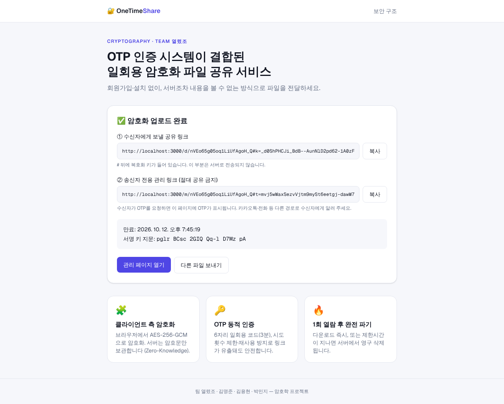
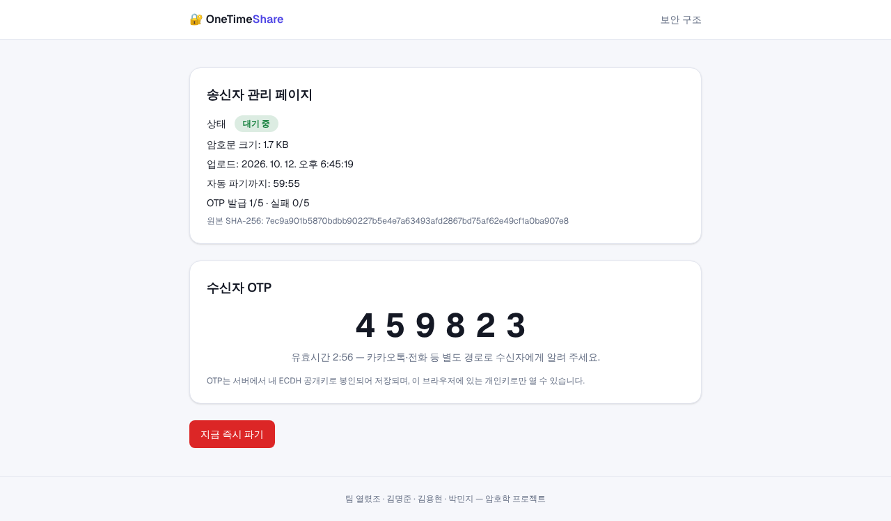
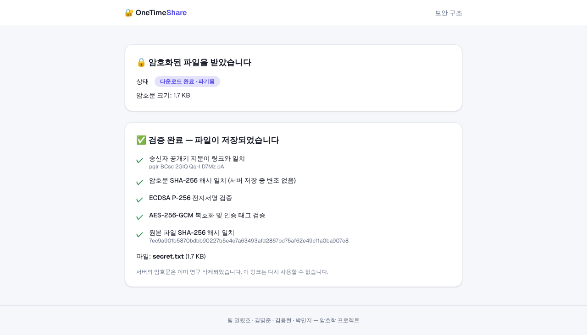
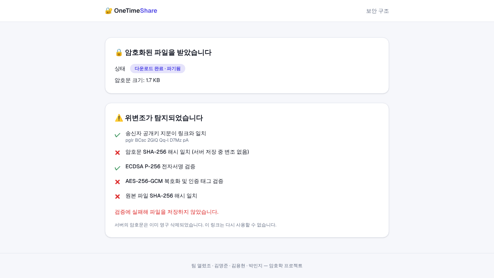

# 작업 과정 설명서

> 업로드된 **회의록 PDF**와 **중간발표 PPTX**를 바탕으로,
> "OTP 인증 시스템이 결합된 일회용 암호화 파일 공유 서비스"를 **TypeScript + Next.js + MongoDB**로 구현한 전 과정을 순서대로 기록했습니다.
> 실행한 명령, 내린 결정과 이유, 중간에 생긴 문제와 해결 방법, 테스트 결과를 모두 담았습니다.

---

## 목차

1. [자료 분석](#1-자료-분석)
2. [설계 결정](#2-설계-결정)
3. [프로젝트 생성 및 패키지 설치](#3-프로젝트-생성-및-패키지-설치)
4. [MongoDB 준비 (문제 발생과 해결)](#4-mongodb-준비)
5. [코드 작성 — 파일별 설명](#5-코드-작성--파일별-설명)
6. [빌드·린트 검사 및 수정](#6-빌드린트-검사-및-수정)
7. [브라우저 E2E 테스트](#7-브라우저-e2e-테스트)
8. [VS Code 개발 환경 구성](#8-vs-code-개발-환경-구성)
9. [테스트 중 발견한 버그와 수정](#9-테스트-중-발견한-버그와-수정)
10. [문서화 및 커밋](#10-문서화-및-커밋)
11. [내 PC에서 실행하는 방법](#11-내-pc에서-실행하는-방법)
12. [한계와 향후 개선점](#12-한계와-향후-개선점)

---

## 1. 자료 분석

### 1-1. 파일 읽기

| 파일 | 사용한 방법 |
| --- | --- |
| 회의록 PDF | `pdftotext -layout`으로 텍스트 추출 |
| 발표 PPTX | PPTX는 ZIP 파일이므로 `unzip`으로 풀고, `ppt/slides/slide1~11.xml`에서 `<a:t>` 태그의 텍스트를 Python으로 추출 |

### 1-2. 추출한 요구사항

**회의록 (PDF)**
- 주제: OTP 인증 시스템이 결합된 일회용 암호화 파일 공유 서비스
- 세부 기능
  - ① **클라이언트 측 암호화**: 서버가 원본과 키를 알 수 없는 Zero-Knowledge 구조
  - ② **OTP 기반 동적 인증**: 접근 제어, 무단 다운로드·재전송 공격 방지
  - ③ **일회성 저장 및 완전 파기**: 잔여 데이터 유출 방지
- 역할분담 상세: 브라우저 키 생성·암복호화, **링크 `#키` 구조**, OTP 발급·검증, **시도 횟수 제한(실패 시 잠금)**, **재사용 방지**, **토큰 해시 저장**, 송신자 서명 생성·검증, 파일 해시 확인, 서명 정보 표시
- 사용 기술: **AES-256-GCM, OTP, 전자서명**
- 기대효과: 설치·회원가입 없이 링크만으로 이용, 1회 열람 후 삭제, 제한시간 후 차단

**발표 자료 (PPTX)**
- Web Crypto API로 브라우저 단독 처리, 키는 URL Hash Fragment(#)로 전달 → 서버 로그에 남지 않음
- OTP: **6자리 난수**, 송신자(또는 수신자) 기기로 전송, **제한 시간 3분**
- 파기: 인증된 **단 하나의 세션**에만 전송 후 즉시 영구 삭제
- 전자서명: **SHA-256** 해시 검증, 송신자 전자서명, 위변조 탐지·경고
- 무차별 대입 공격 방어, 인증 세션 타임아웃

이 요구사항을 기능 목록으로 정리한 뒤 하나씩 구현에 매핑했습니다 (→ 2장).

---

## 2. 설계 결정

### 2-1. 기술 스택

| 영역 | 선택 | 이유 |
| --- | --- | --- |
| 프레임워크 | **Next.js 16.4 (App Router)** | 요청하신 Next.js의 최신 안정 버전. 화면과 API(Route Handlers)를 한 프로젝트에서 처리 |
| 언어 | **TypeScript 5** | 요청 사항. 암호 파라미터의 타입 오류를 컴파일 단계에서 차단 |
| DB | **MongoDB 7** + 공식 `mongodb` 드라이버 7.x | 요청 사항. **TTL 인덱스**로 만료 자동 삭제를 DB 기능으로 해결할 수 있음 |
| 스타일 | Tailwind CSS 4 | create-next-app 기본 구성, 다크모드 지원 |
| 암호 | 브라우저: **Web Crypto API**, 서버: Node `crypto` | 외부 암호 라이브러리 없이 표준 API만 사용 → 검증된 구현 + 의존성 최소화 |

### 2-2. 요구사항 → 구현 매핑

| 요구사항 | 구현 방식 |
| --- | --- |
| 클라이언트 측 암호화 | 브라우저에서 AES-256-GCM 키(256bit)·IV(96bit) 생성. **파일 본문과 파일명/타입(메타데이터)을 각각 암호화**해 서버가 파일 이름도 모르게 함 |
| 링크 `#키` 구조 | 공유 링크 `/d/{id}#k={AES키}&f={서명키 지문}`. `#` 뒤는 HTTP 요청에 실리지 않음. 페이지가 열리면 `history.replaceState`로 주소창에서도 지움 |
| OTP 발급 | Node `crypto.randomInt`(CSPRNG)로 6자리 생성, 유효 3분 |
| 토큰 해시 저장 | OTP → `HMAC-SHA256(서버 비밀값, "id:code")`만 저장. 관리 토큰 → `SHA-256`만 저장 |
| OTP를 송신자 기기로 전송 | 문자/메일 서버가 없으므로, **송신자 관리 페이지**로 전달. 이때 서버가 OTP 평문을 보관하지 않도록 **ECIES**(ECDH P-256 + HKDF + AES-GCM)로 송신자 공개키에 봉인해 저장. 개인키는 관리 링크의 `#` 뒤에만 있음 |
| 시도 횟수 제한·잠금 | 누적 5회 실패 → 상태 `locked` + 암호문 즉시 삭제 |
| 무차별 대입 방어 | 위 잠금 + OTP 3분 만료 + 발급 최대 5회 + 재발급 30초 쿨다운 + 상수 시간 비교(`timingSafeEqual`) |
| 재사용(Replay) 방지 | OTP 소비를 `findOneAndUpdate({ "otp.used": false, … })`로 **원자적**으로 처리 → 동시에 두 세션이 같은 OTP를 보내도 한쪽만 성공 |
| 1회 전송 후 완전 파기 | `findOneAndDelete`로 암호문 문서를 꺼내면서 동시에 삭제, 그 뒤에 응답 |
| 제한시간 후 차단 | `expiresAt` **TTL 인덱스**(MongoDB가 약 60초 주기로 자동 삭제) + 요청이 올 때마다 만료 검사 후 즉시 파기(TTL 주기를 기다리지 않음) |
| 전자서명 | 송신자 브라우저가 **ECDSA P-256 / SHA-256**으로 `"OTS-SIG-v1|암호문해시|원본해시"`에 서명 |
| 서명 검증의 신뢰 기반 | 서버가 공개키와 서명을 통째로 바꿔치기할 수 있으므로, **공개키 지문(SHA-256 앞 16바이트)을 공유 링크 `#f=`에 넣어** 수신자가 대조 |
| 서명 정보 표시 | 수신 화면에 5가지 검증 결과(지문, 암호문 해시, 서명, GCM 태그, 원본 해시)를 ✓/✕로 표시. 하나라도 실패하면 **파일을 저장하지 않음** |
| 설치·회원가입 불필요 | 계정 없이 링크만으로 동작. 송신자 서명 키는 브라우저 localStorage에 보관해 지문이 계속 같게 유지 |

### 2-3. MongoDB 데이터 구조 (컬렉션 2개)

암호문과 상태 정보를 **분리**했습니다. 파일이 파기된 뒤에도 송신자가 "다운로드됨/잠김/만료됨" 상태를 볼 수 있게 하기 위해서입니다.

**`files`**: 암호문 본문만 보관. `expiresAt` TTL 인덱스.
```ts
{ _id, ciphertext: Binary, iv: Binary, metaIv: Binary, metaCiphertext: Binary, expiresAt: Date }
```

**`shares`**: 상태·서명·OTP 정보. 파기 후 24시간 뒤 `purgeAt` TTL로 삭제.
```ts
{ _id, status: "active"|"downloaded"|"destroyed"|"locked"|"expired",
  manageTokenHash, notifyPublicKey, signerPublicKey, signature, plainHash, cipherHash,
  size, createdAt, expiresAt, purgeAt,
  otp: { hash, expiresAt, used, sealed: { epk, iv, ct } } | null,
  otpIssueCount, lastOtpAt, failedAttempts, finishedAt }
```

> 서버(DB)에는 **AES 키, OTP 평문, 원본 파일명이 어디에도 저장되지 않습니다.** 7장 테스트에서 실제 DB를 열어 확인했습니다.

---

## 3. 프로젝트 생성 및 패키지 설치

```bash
# 최신 버전 확인
npm view next version            # → 16.4.0
npm view mongodb version         # → 7.7.0

# Next.js + TypeScript 프로젝트 생성 (비대화형)
npx create-next-app@16.4.0 web --ts --app --eslint --tailwind --src-dir \
    --import-alias "@/*" --use-npm --no-turbopack --yes

# 생성된 web/ 내용을 저장소 루트로 옮김 (중첩 .git 제거)
rm -rf web/.git && mv web/* web/.* . && rmdir web
```

Next.js 16은 학습 데이터와 API가 다를 수 있다는 안내(`AGENTS.md`)가 있어서, `node_modules/next/dist/docs/`에 포함된 공식 문서(Route Handlers, Dynamic Routes, `RouteContext` 타입 헬퍼, Cache Components)를 먼저 읽고 그 방식대로 작성했습니다.

**설치한 패키지**

| 패키지 | 구분 | 용도 |
| --- | --- | --- |
| `next` 16.4, `react` / `react-dom` 19.3 | 의존성 | 프레임워크 (create-next-app) |
| `mongodb` ^7.7 | 의존성 | MongoDB 공식 Node.js 드라이버 |
| `server-only` | 의존성 | DB·서버 암호 모듈이 브라우저 번들에 섞이면 빌드 에러가 나도록 보호 |
| `typescript`, `@types/*` | 개발 | 타입 검사 |
| `eslint`, `eslint-config-next` | 개발 | 린트 |
| `tailwindcss`, `@tailwindcss/turbopack` | 개발 | 스타일 |
| `prettier`, `prettier-plugin-tailwindcss` | 개발 | 코드 포맷 (VS Code 저장 시 자동 정렬) |

```bash
npm i mongodb@7 server-only
npm i -D prettier@3 prettier-plugin-tailwindcss
```

---

## 4. MongoDB 준비

### 문제 ①: 테스트용 MongoDB 바이너리 다운로드 차단

처음에는 실제 DB로 테스트하려고 `mongodb-memory-server`(실행 시 mongod를 받아 메모리에서 돌리는 도구)를 설치했습니다.
하지만 작업 환경의 네트워크 정책이 `fastdl.mongodb.org`를 차단해 바이너리를 받지 못했습니다.

**해결**: 작업 환경에 Docker가 있어서 Docker 데몬을 켜고 공식 `mongo:7` 이미지를 받았습니다. 사용하지 않게 된 `mongodb-memory-server`는 제거했습니다.

```bash
npm rm mongodb-memory-server
sudo dockerd &                       # Docker 데몬 시작
docker pull mongo:7
docker run -d --name crypto-mongo -p 27017:27017 mongo:7
docker exec crypto-mongo mongosh --quiet --eval 'db.runCommand({ping:1})'   # → { ok: 1 }
```

이후 같은 설정을 누구나 재현할 수 있도록 **`docker-compose.yml`** 을 만들었습니다 (8장). 최종 테스트는 compose로 띄운 컨테이너로 진행했습니다.

### 환경변수

| 변수 | 설명 |
| --- | --- |
| `MONGODB_URI` | `mongodb://localhost:27017` (Atlas를 쓰면 `mongodb+srv://…`) |
| `MONGODB_DB` | `crypto_team` |
| `OTP_PEPPER` | OTP HMAC용 서버 비밀값 (32자 이상). 없으면 서버가 시작 단계에서 오류를 냄 |

- `.env.example`: 저장소에 커밋하는 견본
- `.env.local`: 실제 값. `.gitignore`로 **커밋되지 않게** 했고, `OTP_PEPPER`는 `crypto.randomBytes(32)`로 생성

---

## 5. 코드 작성 — 파일별 설명

### 5-1. 라이브러리 (`src/lib`)

| 파일 | 역할 |
| --- | --- |
| `config.ts` | 보안 정책 상수: 최대 10MB, OTP 3분, 쿨다운 30초, 발급 5회, 실패 5회, 보관 시간(10분/1시간/24시간) |
| `encoding.ts` | base64url·hex 변환, 바이트 결합, 서명 메시지 생성 규칙(송신자·수신자 공용), ID 형식 검사 |
| `mongodb.ts` | MongoDB 클라이언트 **전역 캐시**(개발 모드 HMR 때 연결이 계속 늘어나는 것 방지), 컬렉션 타입 정의, **TTL 인덱스 자동 생성** |
| `server-crypto.ts` | 128bit 공유 ID, 256bit 관리 토큰, CSPRNG OTP, HMAC 해시, 상수 시간 비교, **ECIES 봉인**, 공개키 유효성 검사 |
| `client-crypto.ts` | 브라우저 전용: AES-256-GCM 암복호화, SHA-256, ECDSA 서명 키 관리(localStorage)·서명·검증, ECDH 키 생성, ECIES 봉인 해제, URL fragment 파싱 |
| `shares.ts` | 공통 응답 헬퍼(`Cache-Control: no-store`), **파기 함수**(`destroyShare`), 접근할 때마다 만료를 검사하는 `loadShare` |

### 5-2. API (Route Handlers, `src/app/api/files`)

| 파일 | 동작 |
| --- | --- |
| `route.ts` (POST) | multipart로 암호문·IV·서명·공개키를 받음. **입력 검증**(크기, IV 12바이트, 해시 hex 64자, P-256 공개키가 곡선 위의 점인지, 보관 시간 허용 값). 서버도 암호문 SHA-256을 다시 계산해 클라이언트가 보낸 값과 비교. `files`/`shares`에 저장하고 관리 토큰은 해시만 저장 |
| `[id]/route.ts` (GET) | 수신자용 공개 상태. 서명·해시 같은 정보는 OTP 인증 전에는 주지 않음 |
| `[id]/otp/route.ts` (POST) | 쿨다운·발급 횟수 확인 → OTP 생성 → HMAC 해시와 ECIES 봉인본 저장. 이전 OTP는 덮어써 무효화. `otpIssueCount` 조건부 업데이트로 동시 요청이 와도 횟수 제한이 깨지지 않음 |
| `[id]/download/route.ts` (POST) | OTP 형식·만료 확인 → 상수 시간 비교 → 실패하면 `failedAttempts++`, 5회째에 잠금+파기 → 성공하면 원자적으로 OTP를 소비하고 `findOneAndDelete`로 암호문을 꺼내며 삭제 → 암호문·서명·공개키 반환 |
| `[id]/manage/route.ts` (GET/DELETE) | `Authorization: Bearer 관리토큰` 검증(SHA-256 비교). GET은 상태와 봉인된 OTP, DELETE는 즉시 파기 |

### 5-3. 화면 (`src/app`, `src/components`)

| 경로 | 컴포넌트 | 내용 |
| --- | --- | --- |
| `/` | `UploadForm` | 파일 선택(드래그 앤 드롭), 보관 시간 선택, 진행 단계 표시(①암호화 → ③서명 → ②ECDH 키 → 업로드), 완료 후 공유 링크·관리 링크 복사, 내 서명 키 지문 표시·재생성 |
| `/d/[id]` | `DownloadView` | 상태와 남은 시간 → OTP 요청(카운트다운, 남은 시도 횟수) → 인증 후 다운로드 → **5단계 검증 결과** 표시, 모두 통과해야 저장 |
| `/m/[id]` | `ManageView` | 송신자 전용. 3초마다 상태를 조회하고 새 OTP가 오면 브라우저에서 봉인을 풀어 크게 표시, OTP 만료 카운트다운, 즉시 파기 버튼. 새로고침에 대비해 자격 정보를 sessionStorage에 보관 |
| `/about` | - | 단계별 보안 구조와 위협 모델·대응 표 (발표용) |
| 공통 | `ui.tsx`, `layout.tsx`, `globals.css` | 카드·버튼·상태 배지·복사 필드·카운트다운, 라이트/다크 테마 색상 토큰, 한글 폰트 대체 지정 |

Next.js 16의 `cacheComponents` 설정 아래에서 동적 경로가 정상 동작하도록, `d/[id]`·`m/[id]` 페이지는 서버 컴포넌트에서 `<Suspense>`로 감싸고 실제 화면은 클라이언트 컴포넌트에서 `useParams()`로 ID를 읽게 했습니다. (암호 처리는 어차피 브라우저에서만 해야 하므로 클라이언트 컴포넌트가 맞습니다.)

### 5-4. 보안 헤더 (`next.config.ts`)

- `Referrer-Policy: no-referrer` (`<meta name="referrer">`도 추가): 다른 사이트로 URL이 새지 않게 함
- `X-Frame-Options: DENY`: 클릭재킹 방지
- `X-Content-Type-Options: nosniff`, `Permissions-Policy`

---

## 6. 빌드·린트 검사 및 수정

```bash
npx tsc --noEmit
```
→ `Cannot find name 'RouteContext'` 오류. `RouteContext`는 Next.js가 **자동 생성하는 타입**이라 `next typegen`을 먼저 실행해야 합니다.
**조치**: `npx next typegen` 실행 후 통과. 앞으로 잊지 않도록 `npm run typecheck` = `next typegen && tsc --noEmit`으로 스크립트를 만들었습니다.

```bash
npx eslint
```
→ `DownloadView`에서 `react-hooks/set-state-in-effect` 오류 1건. URL fragment는 브라우저에서만 읽을 수 있어 effect 안에서 상태를 설정해야 하는 경우라, 이유를 적은 주석과 함께 해당 줄만 예외 처리했습니다. → **0 errors**

```bash
npm run build
```
→ ✓ 성공. 정적 페이지 `/`, `/about`, 부분 프리렌더 `/d/[id]`, `/m/[id]`, 동적 API 5개.

---

## 7. 브라우저 E2E 테스트

프로덕션 서버(`npm start`)와 실제 MongoDB를 띄우고, **Playwright로 Chromium을 조작**해 사람이 쓰는 것과 같은 방식으로 전체 흐름을 테스트했습니다. 동시에 DB를 직접 조회해 서버에 무엇이 저장되는지 확인했습니다. (테스트 스크립트는 프로젝트에 넣지 않고 작업용 임시 폴더에서 실행했습니다.)

### 결과 (최종 실행)

| # | 시나리오 | 결과 |
| --- | --- | --- |
| 1 | 파일 업로드 후 DB `files` 문서에 평문이 있는가 | ✅ **없음** (필드: `_id, ciphertext, iv, metaIv, metaCiphertext, expiresAt`) |
| 2 | DB `shares`에 AES 키가 저장됐는가 | ✅ **없음** |
| 3 | 관리 페이지를 연 뒤 주소창에서 `#` fragment가 지워지는가 | ✅ 지워짐 |
| 4 | 수신자가 OTP를 요청하면 송신자 화면에 OTP가 나타나는가 | ✅ 3초 안에 표시 |
| 5 | DB의 `otp.hash`가 OTP 평문과 다른가 | ✅ HMAC 해시만 저장 |
| 6 | 틀린 OTP 입력 | ✅ "남은 시도: 4회" 표시 |
| 7 | 올바른 OTP → 다운로드 파일이 원본과 같은가 | ✅ 파일명·내용 **완전히 일치**, 5개 검증 모두 ✓ |
| 8 | 다운로드 후 DB `files` 문서 | ✅ **삭제됨**, `shares.status = downloaded` |
| 9 | 같은 OTP로 다시 다운로드 시도 (Replay) | ✅ `410 이미 파기된 파일입니다.` |
| 10 | **DB의 암호문 1바이트를 직접 변조**한 뒤 다운로드 | ✅ "⚠️ 위변조가 탐지되었습니다", 파일 저장 안 함 |
| 11 | 무작위 OTP 5회 입력 (무차별 대입) | ✅ `423` 잠금, 암호문 삭제, 상태 `locked` |
| 12 | OTP 연속 요청 | ✅ 두 번째 요청은 `429 30초 후에 다시 요청할 수 있습니다.` |
| 13 | 잘못된 관리 토큰 | ✅ `403` |
| 14 | 만료 시각이 지난 공유에 접근 | ✅ 상태 `expired`, 암호문 즉시 삭제 |
| 15 | TTL 인덱스 생성 확인 | ✅ `files.expiresAt_1`, `shares.purgeAt_1` (`expireAfterSeconds: 0`) |

### 화면

| 업로드 완료 | 송신자 관리(OTP) |
| --- | --- |
|  |  |

| 다운로드·검증 성공 | 변조 탐지 |
| --- | --- |
|  |  |

---

## 8. VS Code 개발 환경 구성

> 저는 원격 클라우드 환경에서 작업했기 때문에 **사용자 PC에 VS Code 자체나 확장을 직접 설치할 수는 없습니다.**
> 대신 프로젝트를 열면 **필요한 것이 자동으로 안내·설치되도록** 설정 파일과 설치 스크립트를 만들었습니다.
> npm 패키지는 모두 `package.json`에 기록되어 있어 `npm install` 한 번으로 똑같이 설치됩니다.

| 파일 | 내용 |
| --- | --- |
| `.vscode/extensions.json` | 추천 확장 7개. 폴더를 열면 VS Code가 "권장 확장을 설치하시겠습니까?"라고 물어봄 |
| `.vscode/settings.json` | 저장 시 Prettier 포맷 + ESLint 자동 수정, 프로젝트의 TypeScript 버전 사용, Tailwind 자동완성 |
| `.vscode/launch.json` | F5 디버그 설정 3종 (서버 / Chrome 브라우저 / 풀스택) |
| `.vscode/tasks.json` | MongoDB 시작, 개발 서버, 전체 검사 작업 |
| `docker-compose.yml` | MongoDB 7 컨테이너 + 데이터 볼륨 |
| `scripts/setup.mjs` | **한 번에 설치**: `npm install` → `.env.local` 생성(랜덤 pepper) → `code --install-extension`으로 확장 설치 → `docker compose up -d` (Windows/macOS/Linux 공통) |
| `.prettierrc.json` | Prettier 설정 (줄 길이 120, Tailwind 클래스 정렬) |

**추천 확장**

| 확장 ID | 용도 |
| --- | --- |
| `dbaeumer.vscode-eslint` | ESLint |
| `esbenp.prettier-vscode` | 코드 포맷 |
| `bradlc.vscode-tailwindcss` | Tailwind 클래스 자동완성 |
| `mongodb.mongodb-vscode` | VS Code 안에서 MongoDB 데이터 조회 |
| `ms-azuretools.vscode-docker` | Docker 컨테이너 관리 |
| `mikestead.dotenv` | `.env` 문법 강조 |
| `usernamehw.errorlens` | 오류를 코드 줄 옆에 바로 표시 |

**setup 스크립트 실행 확인**: 작업 환경에서 `node scripts/setup.mjs`를 실행해 npm install, `.env.local` 처리, `docker compose up -d`(MongoDB 시작)까지 성공했습니다. 작업 환경에는 VS Code CLI(`code`)가 없어 확장 설치 단계는 "선택 단계"로 건너뛰었고, 사용자 PC에서는 정상적으로 설치됩니다.

---

## 9. 테스트 중 발견한 버그와 수정

### 버그: 실패한 DB 연결/인덱스 생성 결과가 영구히 캐시됨

**발견 경위**: 테스트용 MongoDB를 `docker run` 컨테이너에서 compose 컨테이너로 바꾼 뒤 확인해 보니 새 DB에 **TTL 인덱스가 없었습니다.**

**원인**: `mongodb.ts`가 "인덱스 생성 완료" Promise를 전역에 캐시합니다. 서버를 재시작하지 않아 이전 DB 기준 캐시가 그대로 쓰였고, 새 DB에는 인덱스가 만들어지지 않았습니다. 같은 구조상 **처음 연결/인덱스 생성이 실패하면 실패한 Promise가 캐시되어 서버를 재시작할 때까지 모든 요청이 실패**하는 문제도 있었습니다 (예: MongoDB보다 웹 서버를 먼저 켠 경우).

**수정**: 실패하면 캐시를 비우도록 `.catch()`를 추가 → 다음 요청에서 다시 시도합니다.

```ts
globalForMongo._mongoIndexes ??= ensureIndexes(db).catch((e) => {
  globalForMongo._mongoIndexes = undefined;
  throw e;
});
```

재빌드·재시작 후 TTL 인덱스가 생성된 것과 E2E 전 항목 통과를 다시 확인했습니다.

### 기타 작업 메모
- 서버를 재시작하면서 `pkill -f "next start"`를 썼는데, 패턴이 명령을 실행한 셸 자신과도 일치해 셸이 함께 종료됐습니다. 프로세스 ID를 확인해 `kill <PID>`로 다시 진행했습니다 (코드에는 영향 없음).

---

## 10. 문서화 및 커밋

- `README.md`: 프로젝트 소개, 빠른 시작, 스크립트, 사용 흐름, 폴더 구조, API 표
- `작업_과정_설명서.md`: 이 문서
- `docs/images/`: E2E 테스트 중 찍은 실제 화면
- 최종 검사: `npm run check`(타입+린트), `npm run build` 통과
- 브랜치 `claude/lucid-brahmagupta-hmwk11`에 커밋 후 push (`.env.local`, `node_modules`, `.next`는 `.gitignore`로 제외)

---

## 11. 내 PC에서 실행하는 방법

### 사전 설치 (최초 1회)
1. **Node.js 20.9 이상**: https://nodejs.org (LTS)
2. **VS Code**: https://code.visualstudio.com (설치할 때 "PATH에 추가" 체크 → `code` 명령 사용 가능)
3. **Docker Desktop**: https://www.docker.com/products/docker-desktop
   - Docker 대신 [MongoDB Community Server](https://www.mongodb.com/try/download/community)를 설치하거나, 무료 [MongoDB Atlas](https://www.mongodb.com/atlas) 클러스터 URI를 `.env.local`의 `MONGODB_URI`에 넣어도 됩니다.

### 실행
```bash
git clone <저장소 주소>
cd crypto_team
git checkout claude/lucid-brahmagupta-hmwk11
code .                 # VS Code로 열기 → 권장 확장 설치 알림에서 "모두 설치"
npm run setup          # 패키지·환경변수·확장·MongoDB 한 번에 준비
npm run dev            # http://localhost:3000
```

### 직접 사용해 보기
1. `http://localhost:3000`에서 파일 업로드 → **관리 페이지 열기**
2. **공유 링크**를 다른 브라우저(또는 시크릿 창)에서 열고 `OTP 요청`
3. 관리 페이지에 뜬 6자리 코드를 입력 → 다운로드 → 검증 결과 확인
4. 같은 링크를 다시 열면 "다운로드 완료 · 파기됨"으로 표시됨
5. VS Code의 MongoDB 확장으로 `mongodb://localhost:27017` → `crypto_team` DB에 접속해 암호문만 저장되어 있는지 직접 확인할 수 있습니다

> ⚠️ Web Crypto API는 **보안 컨텍스트(HTTPS 또는 localhost)** 에서만 동작합니다. 같은 와이파이의 휴대폰에서 `http://192.168.x.x:3000`으로 접속하면 암호화가 동작하지 않으니, 외부에 배포할 때는 HTTPS(예: Vercel + Atlas)를 사용하세요.

---

## 12. 한계와 향후 개선점

| 항목 | 현재 | 개선 방향 |
| --- | --- | --- |
| 파일 크기 | 최대 10MB (MongoDB 문서 크기 16MB 제한) | GridFS 또는 오브젝트 스토리지 + 스트리밍 암호화(청크 단위 GCM) |
| OTP 전달 | 송신자 관리 페이지에서 확인 후 직접 전달 | 이메일/SMS/카카오 알림톡 API 연동, 또는 TOTP 앱 연동 |
| "완전 파기" | MongoDB에서 문서 삭제 (WiredTiger가 공간을 재사용하기 전까지 디스크 블록이 남을 수 있음) | 디스크 암호화(Encryption at Rest) 함께 사용 — 원래 암호문이라 키 없이는 의미가 없음 |
| 요청 제한 | 공유 단위 제한(발급 횟수·쿨다운·실패 횟수) | IP 단위 rate limit 추가 (예: 미들웨어 + Redis) |
| 서명 키 신원 | 브라우저별 로컬 키(지문으로 식별) | 지문을 별도 경로로 미리 교환하거나 인증서/PKI 연동 |
| 자동 테스트 | Playwright 시나리오를 수동 실행 | 저장소에 `@playwright/test` 테스트와 GitHub Actions CI 추가 |
